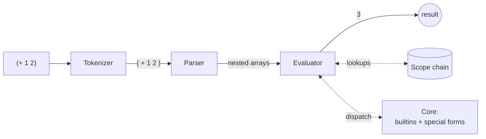

<div align="center">

```
  _   _   _             _ _
 | |_| |_(_)_ __  _   _| (_)___ _ __
 | __| __| | '_ \| | | | | / __| '_ \
 | |_| |_| | | | | |_| | | \__ \ |_) |
  \__|\__|_|_| |_|\__, |_|_|___/ .__/
                  |___/        |_|
```

**A tiny Lisp interpreter in plain JavaScript.**
<br>
Zero runtime dependencies · ~400 lines · real closures · a REPL

[](https://github.com/alex-quiterio/ttinylisp/actions/workflows/build.yml)


</div>

---

## ⚡ Quick start

```sh
git clone git@github.com:alex-quiterio/ttinylisp.git
cd ttinylisp
npm install
npm start
```

```lisp
ttinylisp> (defun fib (n)
|            (if (< n 2)
|                n
|                (+ (fib (- n 1)) (fib (- n 2)))))
FIB
ttinylisp> (fib 20)
6765
ttinylisp> (defparameter make-adder (lambda (n) (lambda (x) (+ x n))))
#<function>
ttinylisp> ((make-adder 10) 5)
15
ttinylisp> (let ((xs (1 2 3 4))) (cons (car xs) (cdr (cdr xs))))
(1 3 4)
```

Unclosed parentheses? The REPL just waits for the next line.

## 📜 Run a script

```lisp
;; examples/hello.lisp
(defun greet (name)
  (print (concat "Hello, " name "!")))

(greet "World")
```

```sh
$ node bin/ttinylisp.js examples/hello.lisp
Hello, World!
3628800
```

## 🧩 Use it as a library

```js
const TinyLisp = require('ttinylisp');

const lisp = new TinyLisp();
lisp.evaluateExpression('(* (+ 3 2) 5)'); // => '25'  (printed form)
lisp.evaluate('(cdr (1 2 3))'); // => [2, 3]  (raw JS value)
```

Each `TinyLisp` instance has its own global environment, so definitions stay
around between calls.

## 📖 The language

### Special forms

| Form                               | What it does                                    |
| ---------------------------------- | ----------------------------------------------- |
| `(if test then else?)`             | Evaluates `then` or `else`, depending on `test` |
| `(let ((name value) ...) body...)` | Binds local names, then evaluates the body      |
| `(lambda (params...) body...)`     | Creates a closure over the current scope        |
| `(defun name (params...) body...)` | Defines a global function (recursion works)     |
| `(defparameter name value)`        | Defines a global variable                       |

### Built-ins

| Kind       | Functions                                       | Example                                 |
| ---------- | ----------------------------------------------- | --------------------------------------- |
| Arithmetic | `+` `-` `*` `/` (any number of args), `%`, `**` | `(/ 100 2 5)` → `10`                    |
| Comparison | `<` `>` `<=` `>=` `=` `eq`                      | `(eq (len (1 2 3)) 3)` → `true`         |
| Lists      | `car` `cdr` `lar` `cons` `len`                  | `(lar (5 4 2 1))` → `1`                 |
| Strings    | `concat`                                        | `(concat "ttiny" "lisp")` → `ttinylisp` |
| I/O        | `print` (returns what it printed)               | `(print "hi")`                          |

### Syntax

- **Numbers:** `42`, `-7`, `3.14`
- **Strings:** `"anything, really!"`
- **Comments:** `; until the end of the line`
- **Lists:** a list whose head isn't a function evaluates to its values, so
  `(1 2 3)` gives you the list `(1 2 3)`.

## 🔬 How it works



| File                                               | Role                                                   |
| -------------------------------------------------- | ------------------------------------------------------ |
| [`ttinylisp/tokenizer.js`](ttinylisp/tokenizer.js) | One pass over the source text, producing tokens        |
| [`ttinylisp/parser.js`](ttinylisp/parser.js)       | Turns tokens into nested arrays and reports bad parens |
| [`ttinylisp/evaluator.js`](ttinylisp/evaluator.js) | Walks the tree and dispatches special forms or calls   |
| [`ttinylisp/core.js`](ttinylisp/core.js)           | Built-in functions and special forms                   |
| [`ttinylisp/scope.js`](ttinylisp/scope.js)         | Linked environments that make lexical scoping work     |
| [`bin/ttinylisp.js`](bin/ttinylisp.js)             | Command line entry point: REPL or script runner        |

## 🛠 Development

```sh
npm test              # run the specs (Jest)
npm run format        # format everything with Prettier
npm run format:check  # what CI runs
```

CI runs the specs on Node 22, 24 and 26 across Linux, macOS and Windows.

## 📄 License

MIT
